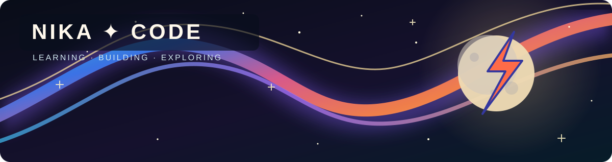
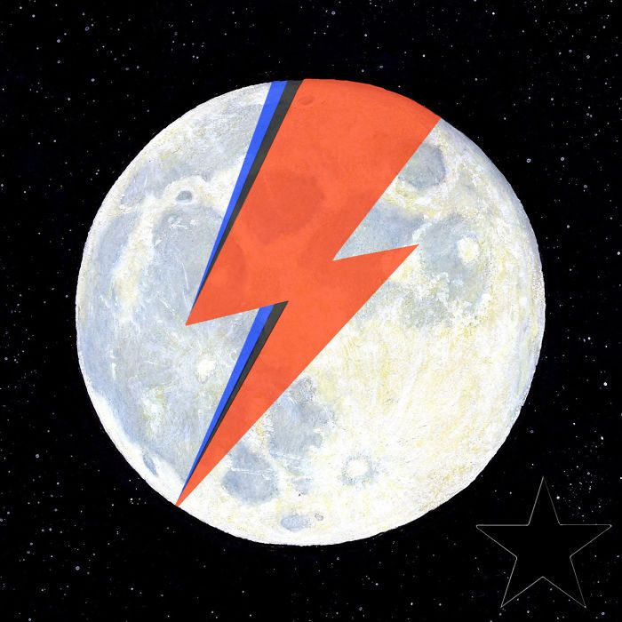

# Hi, I'm Nika ✦

Software engineering student at ITMO

### About me

| A little about me | Illustration |
| :--- | :--- |
| Hey there! I'm Nika 👋 I'm a software engineering student at ITMO. I enjoy turning ideas into working software and learning how things work under the hood. Right now I'm exploring backend development, algorithms, and interactive graphics. |  |

### Education

- 🎓 First-year software engineering student at **ITMO University**.
- 🥈 Graduated from **Lyceum No. 82** with a silver medal.
- ➗ Studied at **YuMSh**, a mathematics school.

### What I'm exploring

- 🤖 I want to learn **machine learning** and build projects with it.
- 🧠 I love mathematics, algorithms, and understanding why an approach works.
- ✨ I'm a fan of **vibe coding**; **Codex** is my favorite coding companion.

### Tech stack

### Contribution trail

### Beyond code

| Interest | A little about me |
| :--- | :--- |
| 🎹 Music | I'm a pianist. I love Oasis, The Police, The Cure, and David Bowie. |
| 🏸 Squash | Candidate Master of Sports in squash. |
| ➗ Mathematics | I enjoy solving problems and finding elegant explanations. |

### GitHub stats

*Curiosity, code, repeat ✦*
